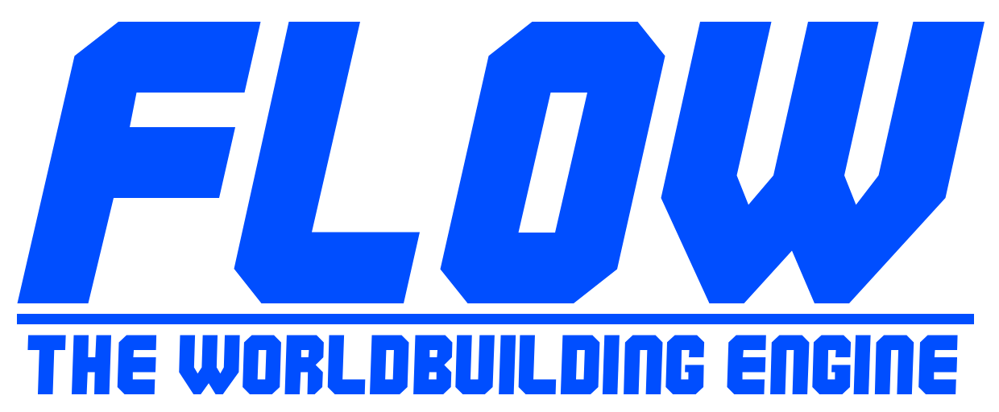
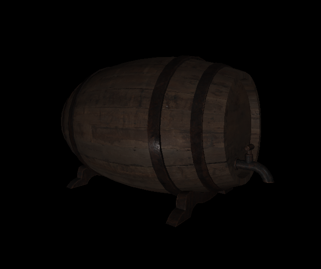
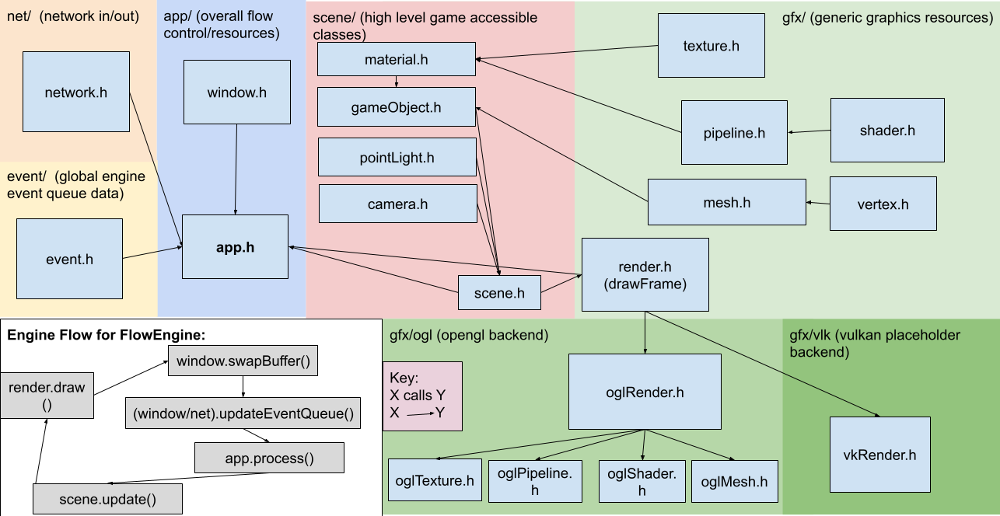

<p align="center">
  
</p>

---

## About
flowEngine is an open source (early in development) game engine. Currently it supports OpenGL, with infrustructure being built to support Vulkan (among other graphics APIs). It is being built and tested currently on Arch Linux, with Windows support planned in the future.

---

## Physical Based Cook-Torrance BRDF 
<p align="center">
  
</p>

---

## Project Structure

<p align="center">
  
</p>

```
src/
  gfx/ (generic graphics structs, etc)
    ogl/ (opengl specific code)
    vlk/ (vulkan specific code)
  gui/ (imgui code)
  scene/ (game engine scene objects/logic)
  net/ (networking...)
  utils/ (generic utils used across all parts of engine)
  core/ (front facing app logic, window interaction, etc)
  events/ (engine wide event queue and processing, the switchboard of the engine)
```

---

## Shader Almanac
You may "#include" GLSL shader files in pipeline shaders to pull in their functions/structs/constants/etc. This provides a modulatized way to write graphics code, made possible by flowEngine's backend graphics pipeline. Check out base.frag to see this in action!

- GLSL <- Function called by pipeline shader
- COMP <- Compute Shader
- VERT <- Vertex Shader
- FRAG <- Pixel Shader
- GEOM <- Geometry Shader
- CTRL <- Tesselation Control Shader
- EVAL <- Tesselation Evaluation Shader

